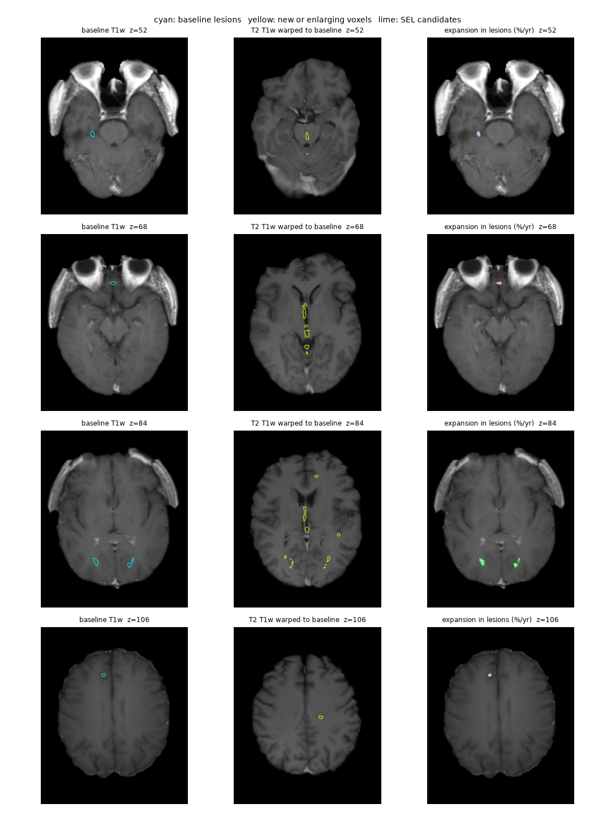

# lesiontrack

[](https://github.com/CedricConday/lesiontrack/actions/workflows/tests.yml)

Longitudinal multiple sclerosis lesion evolution from two or more MRI timepoints:
which lesions are new, enlarging, shrinking, stable or resolved, and which are
**slowly expanding lesions (SELs)** by the Jacobian definition of Elliott et al. 2019,
with a **synthetic backtest gate** that has to pass before a real number is reported.

> **Nothing in this repository is evidence about multiple sclerosis.** It is research
> software. It is not a medical device, it has not been validated against histology or
> clinical outcome, and it makes no diagnostic claim.



## Why this exists

Every MS clinic that pays for follow-up MRI analysis gets lesion-level change and, in
trials, SEL counts. In the open there was one SEL implementation, bound to a GUI, needing
FreeSurfer and ANTs, taking hours per subject and carrying its authors' own warning not
to use it. There is no public SEL ground truth, and the field's thresholds were set by
visual assessment. This package is the missing open engine, and the backtest is the
missing check.

* one dependency for registration: [greedy](https://github.com/pyushkevich/greedy),
  installed as a wheel, x86-64 and arm64, CPU only
* minutes per subject pair, not hours
* every threshold in one file with its citation (`lesiontrack/config.py`)
* every output a plain NIfTI or TSV, on the baseline grid, ready for any viewer

## Method

1. **Halfway space.** Rigid registration of the follow-up T1w to the baseline T1w, then
   the square root of that transform moves both scans into an unbiased midpoint space
   (Nakamura et al.; Elliott et al. 2019).
2. **Deformable registration** driven by T1w and FLAIR jointly (normalised cross
   correlation, step 0.7, update smoothing 2 voxels), baseline fixed, follow-up moving.
3. **Jacobian determinant** of the deformation field, converted to local percent volume
   change per year: `(det J - 1) * 100 / years`.
4. **SEL candidates** (Elliott 2019): voxels inside baseline lesions expanding at
   >= 12.5 %/year seed 18-connected components; each seed grows by hysteresis into
   neighbours expanding at >= 4 %/year, competing so distinct expansions stay distinct
   (marker watershed on the expansion map); candidates under 10 voxels are dropped.
5. **Scores** (Elliott 2019 as described by Vanden Bulcke et al. 2025): *concentricity*
   is the robust slope of mean expansion per 1-voxel shell against depth from the
   candidate edge; *constancy* is the normalised residual of a robust linear fit of
   expansion over the intermediate timepoints (needs three or more scans). Both are
   z-scored across the cohort; `S = z(concentricity) - z(constancy)`; `S >= 0` is a
   definite SEL. Because the z-scores are cohort-relative, the definite/possible split
   is a ranking within your cohort, not an absolute threshold; raw values are kept.
   Candidates with no interior voxel have no concentricity and are marked unscorable.
6. **Lesion tracking** from the binary masks: connected components at baseline and
   follow-up are matched on the bipartite overlap graph, so merges and splits are
   explicit. Volume change is annualised and classified as enlarging or shrinking beyond
   +/-9 %/year, stable within +/-4 %/year, and trend_up / trend_down between (bands of
   Vanden Bulcke et al. 2025). A follow-up component with no baseline overlap is *new* if
   it clears the 1-voxel-dilated baseline mask and *adjacent_fragment* if it touches it;
   a baseline component with no follow-up overlap is *resolved*.

## The backtest gate

`lesiontrack backtest` takes a real baseline (T1w, FLAIR, lesion mask), picks lesions,
expands each by a known volume factor (1.15, 1.25, 1.40) with a smooth radial
deformation, perturbs the whole head rigidly, rescales intensities and adds noise, then
runs the full pipeline on the pair and reports:

* sensitivity: expanded lesions that receive a SEL candidate
* false positive rate: untouched lesions that receive one
* recovery fraction: robust slope of measured against true expansion (1.0 = exact)
* the noise floor inside untouched lesions and, per candidate, how well its mean rate
  separates injected from spurious candidates

It is the only place the pipeline is checked against a known answer. Run it on your own
data before trusting a count. The numbers for MSLesSeg are in the section below.

## Install

```bash
pip install lesiontrack
```

Python 3.10+. Wheels for greedy exist for Linux x86-64 and arm64 and macOS.

## Use

Write a tab-separated manifest, one row per scan, paths relative to the manifest:

```
subject	session	time_years	t1	flair	mask	brainmask
P1	T1	28.09	P1/T1/T1.nii.gz	P1/T1/FLAIR.nii.gz	P1/T1/MASK.nii.gz	P1/T1/brain.nii.gz
P1	T2	28.51	P1/T2/T1.nii.gz	P1/T2/FLAIR.nii.gz	P1/T2/MASK.nii.gz
P1	T3	29.49	P1/T3/T1.nii.gz	P1/T3/FLAIR.nii.gz	P1/T3/MASK.nii.gz
```

`time_years` is any consistent clock (age, or years since baseline). Masks come from
whatever segmenter you trust (LST-AI, SAMSEG, nnU-Net, manual); the brain mask is
optional and only restricts the registration metric.

```bash
lesiontrack run manifest.tsv --out derivatives          # every subject
lesiontrack run manifest.tsv --out derivatives --subject P1
lesiontrack cohort --out derivatives                    # z-scores and S across subjects
lesiontrack backtest --t1 T1.nii.gz --flair FLAIR.nii.gz --mask MASK.nii.gz --out backtest
```

### Two deformable engines

The linear step (similarity since 0.3.0: rigid plus one global scale), the halfway frame
and the reslicing are greedy in both cases; `--engine`
picks what runs on the halfway-space images. `greedy` (default) needs nothing extra.
`ants` uses SyN through [antspyx](https://github.com/ANTsX/ANTsPy), cross-correlation on
T1 and FLAIR jointly, and is how the original SEL studies registered:

```bash
pip install 'lesiontrack[ants]'
lesiontrack run manifest.tsv --out derivatives_ants --engine ants
lesiontrack backtest --t1 T1.nii.gz --flair FLAIR.nii.gz --mask MASK.nii.gz --out backtest_ants --engine ants
```

Both engines write the same files, so the backtest compares them on identical inputs. The
Jacobian determinant is computed by lesiontrack from the warp, in the image's voxel frame,
for either engine; see "The Jacobian is ours" below for why.

Per subject you get, on the baseline grid in halfway space:

| file | content |
|---|---|
| `expansion_<tp>_pct_per_year.nii.gz` | Jacobian-derived local volume change |
| `sel_candidates.nii.gz`, `sel_candidates.tsv` | candidate labels; size, peak and mean expansion, concentricity, constancy |
| `baseline_lesion_labels.nii.gz`, `lesion_labels_<tp>.nii.gz` | lesion components |
| `lesion_tracking.tsv` | one row per matched group with class, volumes, rate, merge/split flags |
| `new_or_enlarging_<tp>.nii.gz` | follow-up lesion voxels outside the dilated baseline |
| `overview_<tp>.png` | four axial slices: baseline, warped follow-up, expansion with SEL outlines |
| `summary.json` | counts, volumes, intervals, every parameter used |

`lesiontrack cohort` adds `sel_cohort.tsv` with `z_concentricity`, `z_constancy`,
`score_S` and `definite_sel`.

## Results on public data

### Backtest on MSLesSeg patient P1 (2026-09-26)

Three synthetic series (seeds 0, 1, 2), each with scans at 0, 0.5 and 1 year, eight of
eighteen lesions expanded by nominal factors 1.15 / 1.25 / 1.40 (analytic mean inside the
lesion 11 to 25 % because elongated lesions extend past the radial window), rigid
perturbation about 1 degree and 1 voxel per scan, intensity rescale 0.9 to 1.1, 2 % noise.
Default registration (greedy stationary-velocity, NCC 3x3x3, halfway space). Numbers
re-measured 2026-09-27 with the corrected Jacobian on the same registrations (the
2026-09-26 values, computed through greedy's `-rj`, are kept in `docs/BACKTEST_NOTES.md`).

| quantity | value |
|---|---|
| recovery fraction (measured / true, robust slope) | **1.16** |
| recovery by lesion size: >= 500 / 100-500 / < 100 voxels (median) | 1.00 / 1.22 / 1.21 |
| candidate sensitivity, Elliott thresholds | 1.00 |
| candidate false positive rate, Elliott thresholds | 0.47 (1.00 on untouched lesions >= 500 voxels, 0.07 under 100) |
| definite SEL (S >= 0, z-scored within the run): sensitivity / FPR | 0.67 / 0.37 |
| noise floor: median peak per-voxel expansion in untouched lesions | 10.8 %/yr |
| candidate mean expansion as a classifier, AUC | 0.99 to 1.00 |

Three conclusions the tool would not have earned without the gate:

1. **The Jacobian recovers the injected expansion in full**, slightly over on small
   lesions (the radial window's falloff is counted in the mean). The earlier "under-reports
   by 3x" was greedy's `-rj` on LAS images, see "The Jacobian is ours" below.
2. **Elliott's candidate rule is noise-limited on confluent lesions.** A one-voxel peak
   over 12.5 %/yr, grown by hysteresis to 4 %/yr, makes a 10-voxel candidate; every
   untouched lesion over 500 voxels produced one. Concentricity and constancy, the
   published filters, stayed weak on six more patients in 0.2.0; with unrounded warps
   (0.3.0) S reaches AUC 0.76. See "Validation beyond P1" and "0.3.0" below.
3. **The candidate's mean rate is the filter that works** (AUC 0.99). It is exposed as
   `min_mean_pct_per_year`; since 0.3.0 it is on by default at 10 (`--min-mean 0` gives
   Elliott's rule). Trade-off on this registration (mean over
   the three seeds):

| min mean (%/yr) | sensitivity | false positive rate |
|---|---|---|
| 0 (Elliott) | 1.00 | 0.47 |
| 8 | 1.00 | 0.20 |
| 10 | 1.00 | 0.07 |
| 12.5 | 0.92 | 0.00 |

Full record with the registration sweep: `docs/BACKTEST_NOTES.md`.

### MSLesSeg cohort (24 patients, 2026-09-26, Jacobian re-measured 2026-09-27)

All longitudinal MSLesSeg patients, baseline against their last scan (median interval
1.5 years, range 0.16 to 6.0), default settings. One patient (P49) was refused by the
input gate: its follow-up T1 in the released dataset has 0.1 % nonzero voxels.

**Lesion tracking, all subjects, last follow-up** (baseline lesions 573, matched groups):
new 216, resolved 250, enlarging 127, shrinking 115, stable 36, trend 45. That churn is
real signal, not just segmentation noise: voxels the masks call new go from FLAIR z 0.73
at baseline to 1.49 at follow-up and only 6 % were already lesion-bright; resolved voxels
go from 1.45 to 0.87. But masks are segmented per timepoint in MSLesSeg, so "new" and
"resolved" also carry every difference between two segmentations.

**SEL candidates.** 484 candidates in 24 subjects, median 16 per subject (12.5 with mean
>= 8 %/yr), 97 definite; the literature reports about 2 to 4 SELs per patient over two
years. On this registration the Elliott rule is noise-dominated on real data as it was on
the backtest, and `min_mean_pct_per_year` around 10 is where the backtest puts the floor.

**The Jacobian and the masks agree in rank, not in size.** Per subject, mask-based total
lesion volume change and the Jacobian integrated over baseline lesions correlate at
Spearman 0.41 (medians +12.5 % by mask, -6.3 % by Jacobian, brain-wide mean -1.5 %). Per
1:1 matched lesion (n = 276) the correlation is 0.22; 0.25 for lesions over 100 voxels.
Masks are segmented per timepoint in MSLesSeg, so their change carries every difference
between two segmentations; the Jacobian sees only displacement of the surrounding tissue,
and its median inside persisting lesions is negative.

Cohort tables: `derivatives/mslesseg/cohort_summary.tsv`, `sel_cohort.tsv`,
`check_volume_change_by_lesion.tsv`, `check_flair_consistency.tsv`
(`scripts/summarize_cohort.py`, `scripts/cohort_checks.py`).

### Validation beyond P1 (2026-11-20)

_These are 0.2.0 numbers, taken from warps greedy had rounded to 0.1 voxel; the 0.3.0
section below has them re-measured._

Same backtest design as for P1 (three seeds, eight lesions expanded per seed, 24 injected
lesions per backtest), lesiontrack 0.2.0 with the corrected Jacobian. The six extra
MSLesSeg patients (P2 P3 P12 P13 P19 P22) were picked before any result was seen.
`scripts/run_validation.sh` runs everything; `scripts/summarize_validation.py` writes
`results/validation_backtests.tsv` and `results/validation_feature_auc.tsv`.

**Seven MSLesSeg patients, greedy** (range over patients, median in brackets):

| quantity | value |
|---|---|
| candidate sensitivity, Elliott thresholds | 1.00 in all seven |
| candidate false positive rate | 0.25 to 0.81 (0.46) |
| definite SEL (S >= 0): sensitivity / FPR | 0.58 to 0.92 (0.71) / 0.06 to 0.42 (0.18) |
| recovery fraction | 0.98 to 1.25 |
| noise floor, median peak in untouched lesions | 10.3 to 18.8 %/yr |

How well each candidate feature separates injected from spurious candidates (AUC,
candidate level, median and range over the seven patients):

| feature | AUC |
|---|---|
| mean expansion rate | **1.00** (0.67 to 1.00) |
| constancy residual (lower = more constant) | 0.78 (0.60 to 0.81) |
| S = z(concentricity) - z(constancy) | 0.64 (0.56 to 0.74) |
| concentricity | 0.58 (0.45 to 0.73) |

The P1 finding holds on more patients: the published filters add little over chance on
this design and the mean rate does the work. Two patients (P12 0.67, P19 0.74) are the
exception; in both, the expanded lesions break into many small candidates (78 and 53
injected candidates for 24 injected lesions) whose mean rate overlaps the noise.

**ANTs SyN against greedy, same synthetic series** (P1 / P2 / P3):

| quantity | greedy | ANTs |
|---|---|---|
| candidates per backtest | 154 / 55 / 61 | 33 / 29 / 27 |
| candidate sensitivity | 1.00 / 1.00 / 1.00 | 1.00 / 1.00 / 1.00 |
| candidate false positive rate | 0.47 / 0.81 / 0.25 | **0.20 / 0.24 / 0.03** |
| definite SEL sensitivity | 0.71 / 0.71 / 0.79 | 0.58 / 0.50 / 0.54 |
| definite SEL FPR | 0.40 / 0.38 / 0.06 | 0.10 / 0.05 / 0.00 |
| recovery fraction | 1.16 / 1.21 / 1.14 | 1.06 / 1.04 / 1.02 |
| noise floor (%/yr) | 10.8 / 16.0 / 10.3 | 10.0 / 9.7 / 6.5 |
| run time, 4 cores | about 12 min | about 5.5 h |

ANTs is smoother: a third or less of the spurious candidates, recovery closer to 1, a lower noise
floor. It also loses about a quarter of the definite calls on truly expanding lesions, so S >= 0
gets more specific and less sensitive. At about 27 times the run time it is the engine for
a final analysis, not for a sweep. (P1 greedy here is the 2026-11-19 re-score, which
scores every candidate; its definite numbers differ slightly from the table above.)

**Lesjak et al. 2016, 20 patients** (two timepoints, 0.72 x 0.72 x 3 mm, expert masks of
lesion *change* only). Lesion masks come from LST-AI (`jqmcginnis/lst-ai:v2.0.0rc1-cpu`,
fast mode) on each timepoint; `scripts/prep_lesjak.py` prepares the inputs and
`scripts/eval_lesjak.py` scores against the expert change. There is no SEL ground truth
in this dataset, so it tests tracking, not SEL detection.

| quantity | value |
|---|---|
| LST-AI change voxels against expert change: Dice pooled / median per patient | 0.38 / 0.33 |
| expert change components touched: all / 1-10 / 10-50 / > 50 voxels | 453 of 846 / 52 of 185 / 219 of 434 / 182 of 227 |
| tracked groups called changed (new, resolved, enlarging, shrinking): sensitivity / specificity / PPV | 0.95 / 0.08 / 0.22 |
| Jacobian per baseline lesion (>= 10 voxels) as a classifier of expert change, AUC | 0.58 |
| Jacobian against mask change rate, matched groups, Spearman | 0.31 (n = 594) |
| SEL candidates: total / median per patient / on expert change | 318 / 9 / 121 |

Tracking on per-timepoint segmentations calls almost everything changed: 1,426 of 2,020
groups are new or resolved, against 282 expert-confirmed. The churn is the segmenter's,
not the tracker's, but the tool reports it as change, and that is what a user gets.
Backtests on three Lesjak patients (03, 06, 07, greedy) at this resolution: candidate
sensitivity 1.00 / 1.00 / 0.96, FPR 0.22 / 0.09 / 0.12, recovery 1.02 / 1.03 / 1.00,
noise floor 5.0 / 2.1 / 4.8 %/yr. Tables: `results/lesjak/`.

### 0.3.0: unrounded warps, similarity step, mean-rate filter on (2026-11-21)

Four changes, and every greedy number above re-run with them (`TAG=v031
scripts/run_v030.sh`, tables in `results/v031/`, cohorts in `derivatives/v031/`). ANTs and
the LST-AI arm were not re-run; their numbers above are 0.2.0, and the first change does
not touch ANTs.

1. **The warp is saved unrounded.** greedy rounds the warp it writes to 0.1 voxel unless
   told otherwise (`-wp`, default 0.1), and lesiontrack takes the Jacobian from that file.
   Every rate up to 0.2.0 sat on steps of about 5 %/yr at a one-year interval, coarser
   than Elliott's 4 %/yr growth threshold. This is the largest change below.
2. **The linear step fits one global scale** (`affine_dof = 7`, `--affine-dof 6` restores
   rigid). A simulated scanner change, every follow-up rescaled by 1 %, made untouched
   lesions look like they were expanding. The cost: whole-brain atrophy is absorbed as
   well, so lesion change is measured relative to the brain.
3. **`lesiontrack run` drops candidates under 10 %/yr mean rate** by default. `backtest`
   still scores every candidate.
4. **Earlier follow-ups land in the right frame.** For a third or later timepoint the
   rigid and halfway matrices were composed in the wrong order. At the small rotations
   seen here the two orders give the same alignment; it is fixed for larger ones.

`summary.json` now reports the residual global scale away from lesions (QC only) and the
halfway volume factor; tracking and candidate volumes are on the halfway grid, the
baseline lesion volume is native.

**P1 to P3, three seeds each, lesion level** (72 expanded, 150 untouched lesions per
condition), sensitivity / false positive rate, 0.2.0 -> 0.3.0:

| condition | Elliott candidate | definite S >= 0 | mean rate >= 10 |
|---|---|---|---|
| no scanner change | 1.00 / 0.37 -> 1.00 / **0.15** | 0.74 / 0.17 -> 0.57 / **0.04** | 0.99 / 0.03 -> 0.99 / 0.03 |
| 0.5 % scale change | 1.00 / 0.49 -> 1.00 / 0.12 | 0.74 / 0.19 -> 0.54 / 0.03 | 0.99 / 0.07 -> 0.99 / 0.03 |
| 1 % scale change | 1.00 / 0.67 -> 1.00 / 0.14 | 0.79 / 0.29 -> 0.54 / 0.05 | 1.00 / **0.18** -> 0.99 / **0.03** |
| FLAIR at 3 mm slices | 0.99 / 0.43 -> 0.99 / 0.23 | 0.64 / 0.18 -> 0.58 / 0.07 | 0.96 / 0.06 -> 0.96 / 0.05 |
| Lesjak 03, 06, 07 | 0.99 / 0.12 -> 0.97 / 0.08 | 0.61 / 0.05 -> 0.61 / 0.03 | 0.96 / 0.03 -> 0.96 / 0.03 |

A 1 % scale change now costs nothing. The Elliott rule and S >= 0 lose most of their
false positives; S >= 0 also loses sensitivity (0.74 -> 0.57), so it is now a specific
but conservative call. The mean rate was already near its ceiling and stays there.

**Seven MSLesSeg patients, greedy, 0.2.0 -> 0.3.0** (median, range):

| quantity | 0.2.0 | 0.3.0 |
|---|---|---|
| candidates per backtest | 154 (55 to 278) | 37 (29 to 152) |
| candidate FPR | 0.46 (0.25 to 0.81) | 0.27 (0.04 to 0.59) |
| definite SEL sensitivity / FPR | 0.71 / 0.18 | 0.71 / 0.10 |
| recovery fraction | 1.16 | 1.17 |
| noise floor, median peak in untouched lesions | 10.8 %/yr | 8.9 %/yr (5.1 to 14.4) |
| AUC mean rate | 1.00 (0.67 to 1.00) | 0.99 (0.87 to 1.00) |
| AUC constancy residual | 0.78 | 0.76 (0.61 to 0.94) |
| AUC S | 0.64 | **0.76** (0.63 to 0.78) |
| AUC concentricity | 0.58 | 0.62 (0.31 to 0.76) |

With unrounded rates S carries real information (0.76), though the mean rate still
separates best. P13 stays the hardest patient (candidate FPR 0.59).

**Greedy 0.3.0 against ANTs 0.2.0** (P1 / P2 / P3): candidates 37 / 35 / 29 against 33 /
29 / 27; candidate FPR 0.27 / 0.48 / 0.04 against 0.20 / 0.24 / 0.03; definite sensitivity
0.50 / 0.50 / 0.71 against 0.58 / 0.50 / 0.54; noise floor 8.9 / 12.3 / 5.1 against 10.0 /
9.7 / 6.5 %/yr. Most of the gap in the ANTs table above was greedy's rounding; ANTs
keeps an edge on P2 and in recovery (1.02 to 1.06 against 1.14 to 1.21).

**Cohorts with the defaults.** MSLesSeg (24 patients): 232 candidates, median 6 per
patient (P2 none), 68 definite; 0.2.0 without the filter gave 484, 16 and 97. Mask against
Jacobian volume change per subject: Spearman 0.40 (0.41). The halfway volume factor spans
0.975 to 1.010, which is how much global scale the linear step took up. Lesjak (20
patients): 208 candidates (median 6.5), 45 definite, 85 on expert change (318 / 62 / 121);
tracking is unchanged, it depends on the masks alone.

## Data used

* **MSLesSeg** (Guarnera et al. 2025, Sci Data 12:920, CC BY): 25 patients with 2 to 4
  timepoints, already in MNI152 1 mm space with a lesion mask per timepoint.
  `scripts/make_manifest_mslesseg.py` builds the manifest; intervals are age differences.
* **Lesjak et al. 2016** longitudinal database (CC BY): 20 patients, 2 timepoints, expert
  masks of lesion change. It has no lesion masks, so they come from LST-AI; see
  "Validation beyond P1".

## The Jacobian is ours

Until 0.2.0 the Jacobian came from greedy's `-rj` in the reslice command. That option
differentiates the composed warp while it is still in physical (LPS, millimetre) units,
along voxel index axes, without the image direction matrix, so it is only right for
images whose voxel axes are LPS-aligned at 1 mm. On a phantom with an identity (RAS)
affine, a sphere growing from radius 8 to 10 voxels (volume ratio 1.95) came back as det
0.68; with a LAS affine, as used by the MSLesSeg scans, as 1.18. For a radial stretch
1+k the true determinant is (1+k)^3; each flipped axis turns one factor into (1-k), so
RAS (two flips) reports (1-k)^2 (1+k), which is below 1 for any expansion, and LAS (one
flip) reports (1-k)(1+k)^2, roughly a third of the true volume change for small k. greedy's standalone `-jac` converts the warp first and is
correct; the reslice path does not (found 2026-09-27, draft report in
`docs/upstream/greedy_rj_direction.md`).

A second loss of precision sat in the warp file itself: greedy writes it rounded to 0.1
voxel by default (`-wp 0.1`), which put every rate on steps of about 5 %/yr. Since 0.3.0
the warp is written unrounded (`-wp 0`, found 2026-11-21).

lesiontrack now computes det(I + grad u) itself from the warp file, after taking the
vectors LPS -> RAS -> voxel units through the inverse affine, and `tests/test_jacobian.py`
checks it under four orientations and anisotropic spacing. Registrations cached under an
older record are not redone; their Jacobian is recomputed from the stored warp.

## Limitations, stated plainly

* The Jacobian sees any local volume change, including registration error at lesion
  edges, atrophy, and interpolation. The backtest measures the pipeline's own noise floor
  on untouched lesions; report it with your SEL counts.
* Two-timepoint studies cannot score constancy; S then rests on concentricity alone and
  is labelled so.
* Thresholds are Elliott's, set by eye in 2019 on 3D scans resampled to 1x1x3 mm. Vanden
  Bulcke et al. 2025 found only weak lesion-level agreement (Dice about 0.4) between SEL
  masks from different segmenters or resolutions. Subject-level counts were stable;
  lesion-level identity was not. Expect the same here.
* Masks are taken as given. A segmenter that hallucinates at follow-up will produce
  "new" lesions; the tool does not second-guess it. On Lesjak with LST-AI masks that is
  specificity 0.08 for "changed".
* Since 0.3.0 the linear step absorbs a global scale, including real whole-brain atrophy:
  lesion expansion is relative to the brain. The simulated scanner change is a pure linear
  scale; a real scanner change also distorts non-linearly, and that is not tested.
* Every SEL number here comes from synthetic expansion injected into real scans. No public
  dataset has SEL ground truth; the backtest measures the pipeline, not the biology.

## References

* Elliott C, et al. Slowly expanding/evolving lesions as a magnetic resonance imaging
  marker of chronic active multiple sclerosis lesions. Mult Scler 2019;25:1915-1925.
* Vanden Bulcke C, et al. Do slowly expanding lesions correspond to chronic active
  multiple sclerosis lesions? An integrated imaging analysis study. medRxiv 2025,
  doi:10.64898/2025.12.03.25341192.
* Guarnera F, et al. MSLesSeg: baseline and benchmarking of a new Multiple Sclerosis
  Lesion Segmentation dataset. Sci Data 2025;12:920.
* Yushkevich PA, et al. Fast automatic segmentation of hippocampal subfields and medial
  temporal lobe subregions in 3 Tesla and 7 Tesla T2-weighted MRI (greedy). 2016.

## License

MIT. Written by Cedric Conday with Claude (Anthropic) as coding partner.
